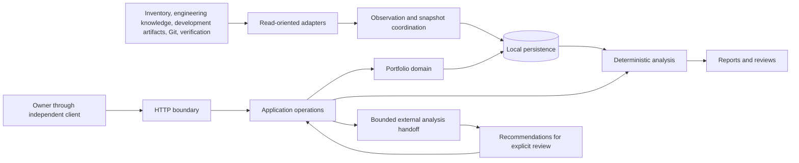

# System architecture

Siddhi sits between existing engineering sources and portfolio decision-making.
The proposed initial deployment is one local Python application with FastAPI
and SQLite, not independently deployed services. A future separate desktop
client uses HTTP. These technology and deployment choices are proposals;
deterministic routine processing, source independence, read-oriented ingestion,
and human control are established direction. This draft records no approval.

# Logical components and dependencies

| Component | Responsibility | Boundary |
|---|---|---|
| HTTP interface | Routing, validated inputs, serialization, access checks, errors, documentation | No source parsing, SQL, or complex portfolio rules |
| Application operations | Coordinate use cases, authorization, transactions, and job lifecycle | Invoke domain behavior and infrastructure ports |
| Portfolio domain | Goals, contributions, outcomes, planning, priorities, and decision semantics | Independent of transport, UI, and SQLite details |
| Source adapters | Discovery, authorized retrieval, format detection, parsing, identity, provenance | Preserve source-specific capabilities and limitations |
| Ingestion coordination | Normalize observations, compare history, capture snapshots and outcomes | Separate processing outcome from content verification |
| Deterministic analysis | Apply explicit criteria to identifiable evidence and portfolio state | No keyword-only proof of achievement or hidden mid-run input changes |
| Reporting and review | Present findings, limitations, plans, reviews, and decisions | Do not become a second source of business rules |
| External analysis boundary | Prepare bounded briefs and validate imported strategic results | Optional; recommendations are not source facts or approvals |
| Persistence | Transactions, integrity, query bounds, migrations, and history | Infrastructure detail behind a data-access boundary |

Dependency direction runs from transport to application coordination to domain
meaning and declared ports. Infrastructure implements those ports. Core rules
do not depend on frontend objects, request objects, source file layouts, or
database paths. Logical modules need not become separate processes or exist
before their capabilities are useful.

The diagram expresses responsibilities and data flow, not required direct
database dependencies for domain objects or a finalized process topology.

# Source-to-report flow

Discovery establishes candidate sources. Retrieval captures accessible input;
format detection selects an explicitly supported parser. Normalization produces
queryable projections with stable identities and revision context. Comparison
uses the previous applicable successful observation. Publication makes a new
usable state visible according to a deliberate consistency boundary.

An ingestion attempt has its own scope, counts, warnings, and processing outcome.
A successfully parsed record does not make an entire scan complete. If an adapter
fails, retain last-known usable data with freshness and coverage qualifications.
Inaccessibility is not deletion. Independently successful scopes may remain
available without falsely claiming a complete portfolio refresh.

Analysis selects goals, criteria, evidence, and snapshots before applying explicit
rules. Findings retain explanations, limitations, inputs, and rule versions.
Reports identify portfolio state and generation time. A rule change and a source
change are different explanations for a changed result. See
[evidence semantics](../concepts/evidence-semantics.md).

# Planning and external reasoning

Portfolio operations are separate from source ingestion. A plan records intended
outcomes, milestones, dependencies, constraints, assumptions, and approval state.
Later evidence can motivate a revision without silently approving it. Reviews
retain the context examined and can conclude that more evidence is needed.

The initial external reasoning proposal exports a structured evidence brief and
imports a structured result. The brief identifies the question, selected inputs,
limitations, and data-sharing scope. Results preserve origin, assumptions,
uncertainty, and recommendations. Direct provider APIs can be added behind
adapters without changing the meaning of decisions. Approval and any repository
publication remain explicit, separately authorized actions.

# Storage and operation

The logical store separates portfolio records, source references, observations,
snapshots, assessments, analysis history, planning history, and operational runs.
Use transactions for consumer-visible consistency; a failed refresh or plan
revision does not partially replace a usable approved state. Schema migrations
and backup/recovery are explicit rather than untracked schema edits.

Short operations can remain synchronous. Larger scans or analyses may justify
background execution, status, retries, cancellation, and recovery. No broker or
distributed queue is implied by logical job tracking. Measure workload before
introducing infrastructure. See [workflow coordination](workflow-coordination.md).

# Trust, diagnostics, and validation strategy

Source documents and imported model output are untrusted data. Routine parsing
does not execute repository instructions, hooks, scripts, or model-suggested
actions. Access is constrained to authorized sources. External sharing is bounded
and explicitly authorized; credentials are not report or snapshot content.

Local deployment does not secure an HTTP service by itself. Binding, client
authorization, origin policy, filesystem permissions, lifecycle, diagnostics,
backup, and recovery still need a threat-model-appropriate design.

Errors identify affected operation, subsystem, partial result, remaining usable
data, retry safety, and required user action without leaking secrets. A source
outage need not disable unrelated local planning.

Validation follows component boundaries: isolated domain and rule tests, adapter
fixtures for supported and unsupported input, transaction and migration tests,
HTTP validation and authorization tests, end-to-end capture-to-report workflows,
equivalent-input determinism checks, and trust-boundary tests.

# Open architecture choices

Confirm source contracts and format coverage, local versus remote-only access,
snapshot publication unit, retained payload/history depth, minimal portfolio
entities, persistent-job needs, local access model, and report formats. Neither
the proposed module layout nor logical diagram settles those decisions.

Related: [data ownership](data-ownership.md), [logical data model](data-model.md),
[modular monolith](../decisions/modular-monolith.md),
[UI-independent HTTP boundary](../decisions/ui-independent-http-boundary.md).